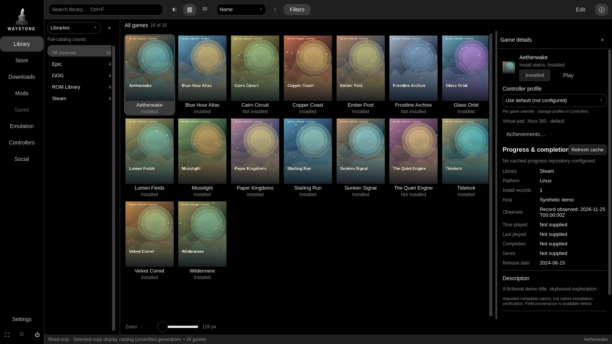
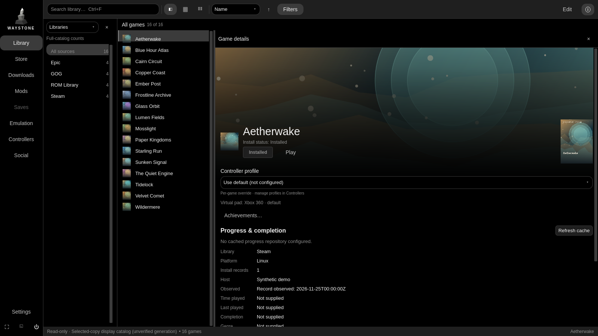
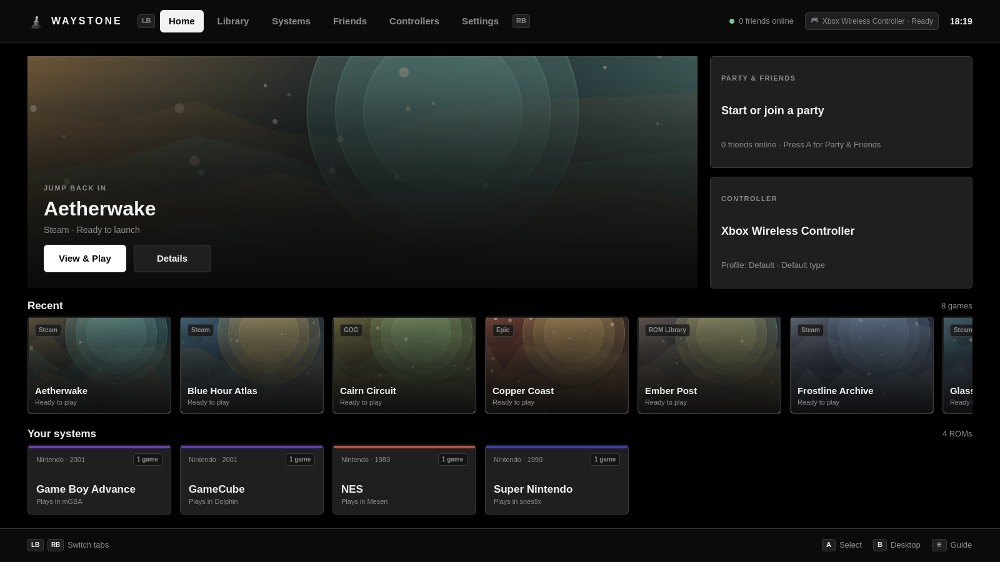
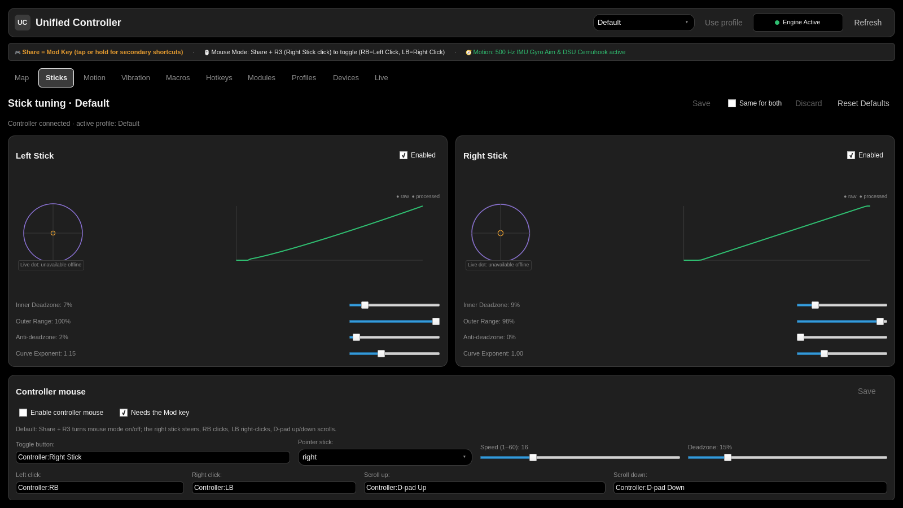

# Waystone

**Your games, launchers, and controllers in one place.** Waystone is an early-stage Linux game library and launcher. It brings local game libraries, a console-style Big Screen, controller profiles, installs, saves, mods, achievements, and social integrations into one Qt desktop app.

> Waystone is still under active development. Provider support varies: some integrations read local launcher data, some use an account or API key you choose to connect, and some features are previews. It does not yet replace every commercial launcher or guarantee that every game installs or runs.

## Screenshots

These screenshots use a reproducible synthetic demo catalog and original artwork generated locally by `tools/render_readme_screenshots.py`; they contain no personal library or account data. Rebuild them with `python3 -B tools/render_readme_screenshots.py` (PySide6 required).

| Desktop library | Game details |
| --- | --- |
|  |  |

| Big Screen home | Controller sticks |
| --- | --- |
|  |  |

The ROM-system cards are non-launchable synthetic fixture records; no ROM files exist. The controller screenshot is rendered with an offline mock service and does not indicate that a physical controller is connected.

## What it does

- **One library:** discover games from supported local sources, including Steam, Heroic and Lutris, plus configured ROM folders and games you add yourself. Import is additive; entries from different stores are not silently merged.
- **Launch and install:** launch supported installed games and manage downloads for supported providers from Waystone. Steam and some other platforms may still need their own client or account session. Provider helpers are fetched from their official release projects on first use and checksum-verified.
- **Big Screen:** a controller-friendly, full-screen view for browsing and starting games.
- **Controllers:** configure supported controller profiles and virtual devices. Virtual-device features need access to Linux `/dev/uinput` and `/dev/uhid`; they are not required just to browse the library.
- **Game management:** Waystone includes developing integrations for saves, mods, achievements, Proton, artwork, and community features. Coverage depends on the game and installed tools; review each operation before applying changes.
- **Stores and prices:** compare offers returned by configured sources. Prices, editions, availability, region, and seller terms can change; always verify on the store's checkout page.

Waystone is not affiliated with Steam, Heroic, Epic Games, GOG, Amazon, Lutris, Microsoft, or other providers. Their names and marks belong to their respective owners.

## Install

### Arch Linux / AUR

Waystone is **not** in the AUR yet. Until it is, build the package yourself from the recipe in [`packaging/arch`](packaging/arch):

```bash
git clone https://github.com/KianJRoss/waystone.git
cd waystone/packaging/arch
makepkg -si
```

Do not install a similarly named third-party package and assume it is this project.

The draft package targets Arch Linux x86_64 and installs Waystone read-only under `/usr/share/waystone`. It builds the .NET 10 controller engine from source. The optional user service is not enabled automatically.

### Run from a source checkout

On Arch Linux, install the runtime dependencies, then start Waystone from the checkout:

```bash
sudo pacman -S python pyside6 qt6-multimedia qt6-svg qt6-webengine python-httpx python-yaml dotnet-runtime libevdev
./open-waystone.sh
```

Optional: `python-websockets` (Xodus chat). To use a different Python (for
example a virtual environment with the same packages), set `WAYSTONE_PYTHON=/path/to/python` in
`~/.config/waystone/waystone.env`.

To build the native controller engine for this writable source checkout (needs `dotnet-sdk`):

```bash
sudo pacman -S dotnet-sdk
tools/build_controller_engine.sh
```

The app stores mutable data under the XDG directories (normally `~/.local/share/waystone`, `~/.config/waystone`, and `~/.local/state/waystone`). It does not need write access to its installed application directory.

## First start and accounts

Waystone can start without signing in. Refresh the library from the available local launchers and configure ROM folders or local games in the app. A provider account is optional and only needed for that provider's account-only features.

- **Steam:** local discovery can read an existing Steam installation. Optional account features may ask for a Steam Web API key and SteamID; credentials are stored locally using the desktop keyring when available. Steam may need to remain running for its social integration.
- **SteamGridDB:** optional API key for artwork lookup. Do not share your key in logs, screenshots, issue reports, or forum posts.
- **Epic, GOG, Amazon:** Waystone downloads the pinned `legendary`, `gogdl`, or `nile` helper from its official GitHub release on first use, verifies the SHA-256 digest, and stores it in the Waystone data directory. Account sign-in is provider-specific.

No account is required to browse a local library. Avoid entering credentials into a prompt unless you initiated that provider connection in Waystone.

## Privacy and downloads

Waystone's library, settings, cache, and provider-helper files are stored on your machine. Local library refresh reads supported launcher metadata; it does not upload your library to Waystone's developers. Network requests can go to configured providers when you use online features such as provider sign-in, artwork or price lookup, achievements, voice/social services, or downloading a provider helper. The AI assistant sends the prompt and selected tool context to the AI backend you configure; connected tools may read or change local data as their permissions allow. Providers and services have their own privacy policies and may receive account or query information. Downloads and game installs use the selected provider and destination shown in the UI.

The controller udev rule only tags `/dev/uinput` and `/dev/uhid` for the active local desktop user (`uaccess`); it does not grant all users access. Reload udev rules or reconnect devices after installation if the devices are not available. Do not run Waystone as root.

## License and contributions

Waystone is licensed under [AGPL-3.0](LICENSE). Third-party components and notices are listed in [THIRD_PARTY_NOTICES.md](THIRD_PARTY_NOTICES.md). Contributions should preserve those notices and include tests for behavior changes.

Bugs and ideas: https://github.com/KianJRoss/waystone/issues
